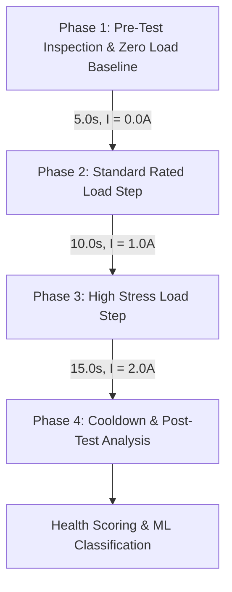

# ChargeGuard AI Pro — Standard Test Protocol (SOP-CG-001)

## Title: Fixed 5.0 V DC USB Cable & Adapter Health Verification Protocol
**Document Version:** 1.0  
**Classification:** Quality Assurance & Engineering Diagnostic Standard  
**Target Profile:** Fixed 5.0 V DC (Nominal 4.75 V to 5.25 V permissible window)

---

## 1. Scope & Objective

This Standard Operating Procedure (SOP) defines the mandatory methodology for evaluating the electrical integrity, loop resistance, contact degradation, and thermal performance of USB charging cables and power adapters under a fixed 5.0 V DC regime.

The goal is to detect:
1. Contact surface oxidation and terminal micro-fretting.
2. Internal copper wire strand breakage and crimp joint degradation.
3. Abnormal voltage drop causing slow charging or peripheral resets.
4. Latent thermal runaway risks from high-resistance hotspots.

> [!CAUTION]
> **Single-Ended Measurement Prohibition:**
> Under no circumstances may cable resistance ($R_{loop}$) or true cable voltage drop ($\Delta V$) be calculated using only a single voltage sensor. Calculating cable voltage drop requires simultaneous measurements of:
> 1. Source-side voltage ($V_{source}$) at the power supply connector.
> 2. Sink-side voltage ($V_{sink}$) at the electronic dummy load terminal.
>
> If only one voltage reading is available, the software must report "Single-Ended Measurement — Differential Metrics Unavailable" and must never synthesize or fabricate resistance figures.

---

## 2. Test Hardware Setup

The test setup consists of:
- **Regulated 5.0 V DC Power Source**: Low-ripple bench supply (minimum 5.0 V ± 0.5%, 3.0 A capability).
- **ChargeGuard ESP32 Bench Node**: Dual-channel INA219 current/voltage monitors or precision differential ADC, DS18B20 digital thermal sensor clamped to the cable sink connector neck, and opto-isolated load control relay.
- **Programmable Constant-Current (CC) Electronic Load**: Step-selectable 0.0 A (idle), 1.0 A (standard load), and 2.0 A (stress load).

---

## 3. Four-Phase Test Execution Procedure

### Phase 1: Pre-Test Baseline (Duration: 5 seconds, Current: 0.0 A)
1. **Mechanical Inspection**: Verify USB connectors are clean, free of debris, lint, or visible corrosion. Inspect cable jacket for kinks or exposed copper strands.
2. **Open-Circuit Voltage ($V_{OC}$)**: Measure source voltage without load ($I = 0.0\text{ A}$).
   - **Nominal Expectation**: $4.95\text{ V} \le V_{source} \le 5.25\text{ V}$.
   - **Baseline Thermal Reading**: $T_0 \le 35.0^\circ\text{C}$ (ambient benchmark).
   - If $V_{source} < 4.75\text{ V}$ or $V_{source} > 5.50\text{ V}$, abort test immediately with **Source Voltage Out of Bounds**.

### Phase 2: Standard Rated Load Step (Duration: 10 seconds, Current: 1.0 A)
1. Engage electronic load in Constant Current mode at $I_{target} = 1.00\text{ A} \pm 0.05\text{ A}$.
2. Record differential telemetry at 5 Hz to 10 Hz:
   - $\Delta V_{1A} = V_{source} - V_{sink}$
   - $R_{1A} = \frac{\Delta V_{1A}}{I_{actual}}$
   - $P_{loss, 1A} = \Delta V_{1A} \times I_{actual}$
   - $\Delta T_{1A} = T_{current} - T_0$
3. Evaluate stability: Check for jitter or sudden voltage ripple ($\sigma_V > 50\text{ mV}$).

### Phase 3: High Stress Load Step (Duration: 15 seconds, Current: 2.0 A)
1. Transition electronic load to $I_{target} = 2.00\text{ A} \pm 0.08\text{ A}$.
2. Measure thermal dissipation rate ($dT/dt$) and voltage drop under peak dissipation.
3. Monitor temperature strictly. If $T \ge 40.0^\circ\text{C}$, trigger **WARNING: Connector Thermal Rise**.
4. If $T \ge 50.0^\circ\text{C}$, the firmware and software safety interlock will trigger an **IMMEDIATE EMERGENCY STOP**.

### Phase 4: Cooldown & Diagnostic Finalization (Duration: 5 seconds, Current: 0.0 A)
1. Disengage dummy load ($I = 0.0\text{ A}$).
2. Confirm voltage returns to open-circuit baseline within 500 ms.
3. Compute consolidated statistics: $R_{avg}$, $V_{drop, max}$, $\Delta T_{max}$, noise variance, and trigger rule diagnostics.

---

## 4. Engineering Thresholds & Acceptance Criteria

| Parameter | Unit | Good (Pass) | Marginal (Warning) | Critical (Fail) |
|---|---|---|---|---|
| **Voltage Drop ($\Delta V$ @ 2A)** | Volts | $\le 0.250\text{ V}$ | $0.250\text{ V} < \Delta V \le 0.500\text{ V}$ | $> 0.500\text{ V}$ |
| **Total Loop Resistance ($R_{loop}$)** | $\Omega$ | $\le 0.150\ \Omega$ | $0.150\ \Omega < R \le 0.250\ \Omega$ | $> 0.250\ \Omega$ |
| **Connector Temperature ($T$)** | $^\circ\text{C}$ | $< 40.0^\circ\text{C}$ | $40.0^\circ\text{C} \le T < 50.0^\circ\text{C}$ | $\ge 50.0^\circ\text{C}$ |
| **Contact Resistance Fluctuation ($\sigma_R$)** | $\Omega$ | $< 0.015\ \Omega$ | $0.015\ \Omega \le \sigma_R < 0.040\ \Omega$ | $\ge 0.040\ \Omega$ (Intermittent) |
| **Minimum Sink Voltage ($V_{sink}$ @ 2A)** | Volts | $\ge 4.750\text{ V}$ | $4.500\text{ V} \le V_{sink} < 4.750\text{ V}$ | $< 4.500\text{ V}$ (Brownout risk) |

---

## 5. Safety Interlocks & Emergency Stop Procedures

### Hardware Hardware Interlock
- Hardware relay or P-channel MOSFET gate in series with the electronic load is actively driven by ESP32 GPIO.
- Firmware watchdog cuts relay gate drive if:
  1. $V_{source} > 5.50\text{ V}$ (overvoltage protection).
  2. $T_{probe} \ge 50.0^\circ\text{C}$ (overtemperature safety stop).
  3. Keep-alive heartbeat from backend fails for $> 2.0\text{ s}$.

### Software Interlock
- Both Backend API and Frontend UI provide high-priority `emergency-stop` signals.
- In any emergency stop event:
  - Active session state is flagged `ABORTED` or `CRITICAL_STOP`.
  - Audio-visual alert banner flashes red across all connected dashboard clients.
  - Test session cannot be restarted without manual operator acknowledgment.
